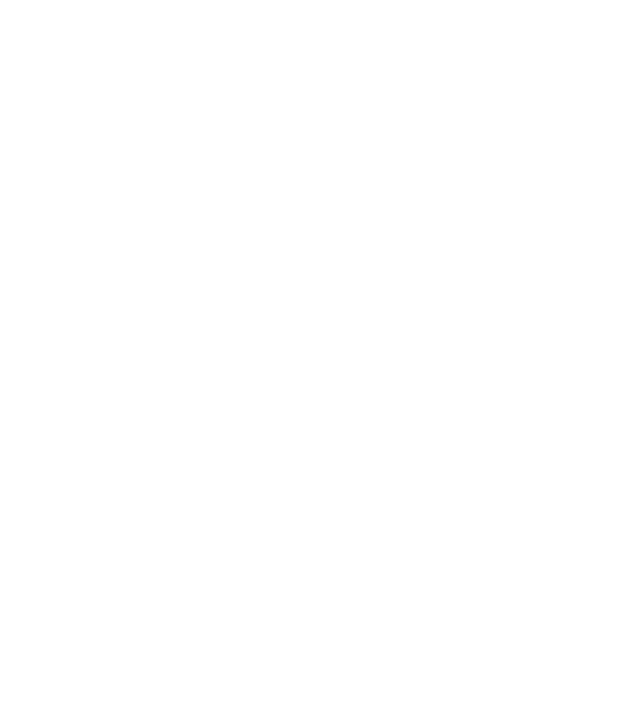

# OKAMI

**Hobby developer, Linux tinkerer, worldbuilder and curious creator.**

[About](#about) · [Featured](#featured-bigify) · [Projects](#projects) ·
[Tools](#tools-and-interests) · [Videos and streams](#videos-and-streams)

## About

I'm Okami, a hobby developer who likes turning personal ideas into useful
tools, experiments, long-term projects and worlds to explore. I build for my
own setup and interests first, then share the results publicly when they
become useful, interesting or simply fun for others too.

I work at my own pace, try new technologies, and shape each project around
how I would actually use, play or explore it.

> [!NOTE]
> **On AI-assisted development.** I use AI coding assistants (LLMs) as a tool
> when I need them, to learn new languages and technologies faster and to get
> ideas built sooner. I review, test and use everything I publish, and my goal
> is to understand and improve every part of my projects myself over time.
> Each repository says how it was made, so you always know what to expect.

## Featured: Bigify

  

  <strong><a href="https://github.com/ShadowOkami4/bigify">Bigify</a></strong>: a 10-foot, controller-first Spotify Connect client for Linux TVs,
  Steam Machines and Steam Deck. Built with Rust, Qt Quick and librespot.

  
  
  

  

## Projects

| Project | What it is | Status |
|---|---|---|
| [**Bigify**](https://github.com/ShadowOkami4/bigify) | A controller-first Spotify Connect client for the living room: immersive Now Playing, synced lyrics, D-pad search and a Library built for TVs and Steam Deck. |  Available as a Flatpak. |
| [**Voidline**](https://github.com/ShadowOkami4/Voidline_Showcase) | An experimental desktop experience and shell around Hyprland, planned across Quickshell, Python, Lua and Rust. |  The current repository is an **AI-generated showcase**; the real implementation is in development. |
| **LunaEcho** | A Discord bot for moderation, tickets, music, leveling and temporary voice channels, with self-hosted or managed access. |  A public repository is planned. |
| [**StreamNotifier**](https://github.com/ShadowOkami4/StreamNotifier) | A small utility that sends a Discord notification when a stream goes live. |  Public and ready to try. |
| [**MirrorGate**](https://github.com/ShadowOkami4/Mirrorgate) | An open-source D&D 5.5e world setting presented as an interconnected Obsidian vault, where broken time, folded roads and dangerous reflections shape one shared realm. |  Planned: 10 one-shots, 5 short adventures, 3 campaign frameworks, plus subclasses, feats, magic items and monsters. |

## Tools and interests

| Area | |
|---|---|
| **Languages** |      |
| **Platforms** |      |
| **Creative** |    |

These are the tools and creative areas in my current projects and
experiments, not a list of things I claim to have mastered.

## Videos and streams

| | |
|---|---|
| [**YouTube**](https://www.youtube.com/@shadowokami04) | Gaming videos and project showcases: feature previews, demos and progress updates. |
| [**Twitch**](https://www.twitch.tv/shadowokami_) | A separate hobby: gaming and relaxed streams, not coding. |

## Support

If something I made was useful or fun for you, you can buy me a coffee:

---

  Built for fun. Shared with everyone.

